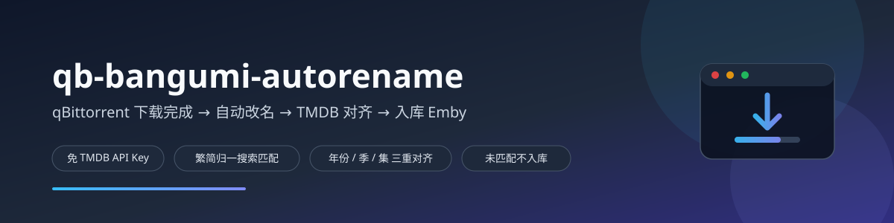
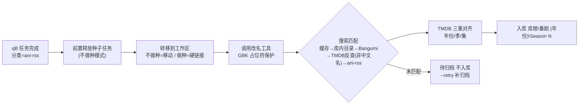
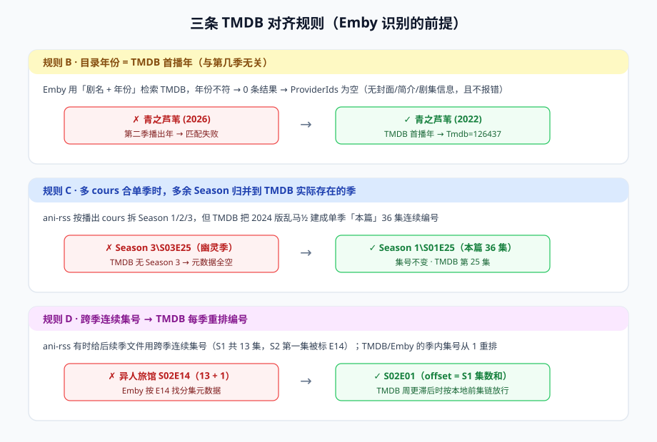

<div align="center">



**qBittorrent 下载完成 → 自动改名 → TMDB 对齐 → 入库 Emby 媒体库**

一站式番剧自动化归档：无需 TMDB API Key（可选填则走官方 API），繁简归一搜索匹配，年份/季/集三重 TMDB 对齐，匹配不到绝不入库。

  

</div>

---

> 📖 **新用户从这里开始**：[从零跑通教程](docs/tutorial.md)（分步安装与验证） · [常见问题](docs/faq.md) · [完整更新记录](docs/CHANGELOG.md)

## 背景

用 ani-rss + qBittorrent 自动追番时，下载完成的文件名五花八门，直接丢进 Emby 经常识别失败。本项目把「改名 → 匹配 → 入库」整条链路自动化，并解决了几类最隐蔽的坑（都来自真实翻车现场）：

1. **目录年份写错** → Emby 检索 TMDB 返回 0 条，条目退化为无元数据且不报错
2. **多 cours 被拆成多个 Season** → TMDB 合并单季连续编号，多余的 Season 成为「幽灵季」
3. **跨季连续集号** → `S02E14` 其实是 `S02E01`
4. **Emby 的季列表只是本地目录回声** → 「`Season N` 存在」≠「TMDB 有该季」

## 工作流程



<div align="center"></div>

## 核心特性

- **做种方式可选**：不做种（默认，直接移动不留副本）或做种（硬链接/复制，qB 继续上传）；`--seed` / `--no-seed` 临时覆盖
- **免 TMDB API Key**：经 Emby `RemoteSearch` 反查首播年与季结构；可选填 Key 走 TMDB 官方 API，不填则解析官网页面，同样可用
- **搜索匹配制**：缓存 → 库内已有目录（繁简/标点/年份归一）→ Bangumi 规范名 → TMDB 反查兜底（仅非中文标题，中文名二次反查可新建目录）→ ani-rss 目录名回退；全不命中就不入库，不瞎猜
- **年份/季/集三重 TMDB 对齐**：目录年份对齐 TMDB 首播年、季结构以 TMDB 官方数据为准、跨季集号自动重排；季结构缓存 3 天
- **主/备组角色感知**：配好 ani-rss 后，同集多字幕组版本按订阅角色自动路由（主组替换备组、备组遇主组丢弃），叠加全局组优劣表、同组新版整套替换、同大小去重四级裁决
- **本地回声保护**：TMDB 把「第 N 期」建成独立新条目（自身仅 S1）时，自动归并回 `Season 1` 并迁移既有文件
- **季归属手工覆写**：`SEASON_OVERRIDES` + `ep_offset`（正=续排 / 负=回排），自动裁决不动时的配置级兜底
- **同名不同版分离**：重制版 vs 旧版按年份距离拒配（乱马½ 1989/2024），绝不错归
- **改名工具兜底**：英文点分(scene)发布名自动预改写、GBK 超集字符占位符保护、集号按 qB 任务名守卫校正
- **失败安全**：冲突绝不覆盖（旧版移入带时间戳的冲突备份）；匹配不到进待归档；改名失败保留完整现场；`failures.jsonl` 结构化记录
- **日志与通知**：按天分段日志（滚动+清理）；钉钉每次运行汇总一条卡片（可选）

## 安装

> 分步安装指引见 [docs/tutorial.md](docs/tutorial.md)。

```bash
git clone https://github.com/DaisySG297/qb-bangumi-autorename.git
pip install zhconv   # 繁简转换（也可放到脚本同目录 _vendor/ 下）
```

**自备改名工具**：本项目驱动一个独立的番剧批量改名 CLI，见姊妹仓库 [bangumi-rename-for-emby](https://github.com/DaisySG297/bangumi-rename-for-emby)，成品 EXE 见其 [Releases](https://github.com/DaisySG297/bangumi-rename-for-emby/releases/latest)，**建议 v1.3+**（v1.1 修复 GBK 崩溃、v1.2 修复 `[01v2]` 集号解析、v1.3 修复 `U-17` 连字编号误判）。

## 配置

全部通过环境变量（前缀 `QBR_`），无配置文件依赖：

| 环境变量 | 默认值 | 说明 |
|---|---|---|
| `QBR_TOOLS_DIR` | 脚本所在目录 | 工具目录：脚本 / 改名 exe / 日志 / 工作区 / 依赖集中于此，与下载暂存区**严格分开** |
| `QBR_RENAME_EXE` | `<工具目录>\番剧批量重命名(字幕版).exe` | 第三方改名工具路径 |
| `QBR_LIBRARY_DIRS` | `D:\Media\Bangumi` | 媒体库根目录，**多个用 `\|` 分隔**；第一个根用于新建目录 |
| `QBR_NSFW_LIBRARY_DIRS` | （空） | 额外参与**既有目录匹配**的库根（如独立 NSFW 媒体库），新建目录不落这里 |
| `QBR_CONFLICT_DIR` | `<工具目录父级>\MediaConflictBackup` | 冲突备份根目录（**勿放在 Emby 库根内**，否则会被索引成幽灵条目） |
| `QBR_STAGE_DIR` | `<工具目录父级>\下载暂存` | 暂存根目录（ani-rss 下载目录），处理完应只剩下载内容 |
| `QBR_QB_HOST` | `http://127.0.0.1:8080` | qBittorrent WebUI 地址 |
| `QBR_QB_APIKEY` | （空） | qB WebUI API Key（删除种子需要） |
| `QBR_EMBY_HOST` | （空） | Emby 服务器地址，如 `http://192.168.1.10:8096` |
| `QBR_EMBY_APIKEY` | （空） | Emby API Key |
| `QBR_TMDB_APIKEY` | （空） | 可选。TMDB v3 API Key（[免费申请](https://www.themoviedb.org/settings/api)）。填了则季列表走官方 API；留空则解析 TMDB 官网页面，功能不受影响 |
| `QBR_CATEGORY` | `ani-rss` | 只处理该分类的种子 |
| `QBR_ANIRSS_HOST` | （空） | ani-rss 地址；配置后启用主/备组角色识别 |
| `QBR_ANIRSS_KEY` | （空） | ani-rss 的 apiKey（WebUI 设置页可见） |
| `QBR_TRANSFER_MODE` | `no_seed` | 转移方式：`no_seed`=不做种，直接移动不留副本；`seed`=做种，硬链接/复制保留原文件 |
| `QBR_SEED_ACTION` | `delete` | 仅不做种模式生效：处理开始时**前置**删除 qB 种子任务（`deleteFiles=false`，文件保留供搬移入库，避免 qB 报 I/O 错误；`pause` 暂停 / `keep` 不动）；做种模式下忽略 |
| `QBR_DINGTALK_WEBHOOK` | （空） | 钉钉群自定义机器人 Webhook（填了才启用通知） |
| `QBR_DINGTALK_SECRET` | （空） | 加签密钥（`SEC` 开头） |
| `QBR_DINGTALK_ENABLED` | 有 Webhook 时为 `true` | 总开关 |
| `QBR_DINGTALK_KEYWORD` | `番剧入库` | 消息标题关键词（配套「自定义关键词」安全设置） |
| `QBR_DINGTALK_AT_ALL` | `false` | 是否 @所有人 |
| `QBR_BGM_UA` | `qb-bangumi-autorename/1.0` | 请求 Bangumi API 的 User-Agent |

## qBittorrent 触发配置

> 设置 → 下载 → 「Torrent 完成时运行外部程序」：

```
pythonw.exe C:\path\to\qb_rename_move.py "%N" "%F" "%D" "%L" "%G" "%I"
```

⚠️ **占位符陷阱**（qB 5.x 实测）：`%L` 是**分类**、`%G` 是标签；`%C` 是文件数不是分类。传错了会静默跳过、什么都不发生。更多配置坑与验证方法见[教程](docs/tutorial.md)。

## 使用

```bash
python qb_rename_move.py            # qB autorun 正常入口
python qb_rename_move.py --retry    # 重扫 待归档\ 目录补归档（建议挂每日计划任务）
python qb_rename_move.py --dry-run  # 演练：工作区用硬链接，不动真实文件
python qb_rename_move.py --seed     # 本次运行强制做种
python qb_rename_move.py --no-seed  # 本次运行强制不做种
python qb_rename_move.py --test-notify  # 钉钉通知链路自检
```

## 命名规则总览

| 规则 | 处理 |
|---|---|
| **A · 目录对齐** | 库内已有同一部番（繁简/译名/年份归一后匹配）→ 沿用既有目录，不另建分叉 |
| **B · 年份** | 目录年份 = TMDB 首播年；不符则自动改名目录 + 改写 `tvshow.nfo` |
| **C · 季归并** | 文件季号不在 TMDB 季列表 → 归并到 TMDB 实际存在的季（集号不变） |
| **C′ · 本地回声保护** | 季条目「存在却无 provider 元数据」→ 判定 TMDB 无该季，归并回 `Season 1` 并迁移既有文件 |
| **D · 集号重排** | 跨季连续集号 → 按 TMDB 每季重排编号改写（TMDB 周更滞后时按本地前集链放行） |
| **E · 手工覆写** | `SEASON_OVERRIDES`（季归属）+ `ep_offset`（正=续排 / 负=回排），配置级兜底 |
| **同名不同版分离** | 与该季播出年相差超 5 年的既有目录不匹配（重制版另建目录） |
| **未匹配不入库** | 走完全部匹配仍未命中 → 进 `待归档\`，目标目录出现后 `--retry` 自动补归档 |

<details>
<summary><b>SEASON_OVERRIDES 配置示例（点开查看）</b></summary>

```python
SEASON_OVERRIDES = [
    {"show": ["新网球王子 U-17世界杯篇"],           # 子串命中库目录名
     "file": ["世界杯决赛成员决定战", "決勝メンバー決定戦", ...],  # 子串命中原始文件名/qB 任务名
     "season": 3},
    {"show": ["东京复仇者"],                        # 续作并入合并单季
     "file": ["三天战争篇", "santen sensou", "three titans"],
     "season": 1,
     "ep_offset": 50},                          # 绝对集号续排: E01/E02 -> S01E51/E52
    {"show": ["归还者的魔法要特别", "重生者的魔法一定要特别"],   # 发布源用跨季绝对编号
     "file": ["kikansha no mahou wa tokubetsu desu", "第二季", "第2季"],
     "season": 2,
     "ep_offset": -12},                         # 绝对集号回排: E13 -> S02E01
]
```

`show` 与 `file` **同时**命中才生效（t2s + 去标点归一化后比对），命中后覆盖此前一切季推断；未命中完全不影响原流程。`ep_offset` 可正可负（负值回排，结果 `< 1` 时拒绝改写）；条目也可省略 `season` 只做集号偏移。

</details>

## 常见问题

**Emby 里某番剧没封面/没简介？**
大概率年份/季/集与 TMDB 不对齐。查条目 `ProviderIds` 是否为空，按规则修正后对条目 `Refresh`（`ReplaceAllMetadata: true`）。

**qB 配置了 autorun 但不触发？**
查 ini 段层级（qB 5.x 必须顶层 `[AutoRun]`）与占位符（`%L`=分类）；用 WebUI API 写入并回读验证最可靠。

**qB 弹 I/O 错误(file_open)？**
脚本 < v32 的时序问题，升级即可。详见 [CHANGELOG v32](docs/CHANGELOG.md)。

更多边角案例（幽灵季、本地回声、跨季集号、同名重制版、TMDB 403/401……）见 **[docs/faq.md](docs/faq.md)**。

## 更新记录

| 版本 | 变更 |
|---|---|
| v32 | 不做种模式改为前置释放种子，根治 qB I/O 错误弹窗 |
| v31 | 同名不同版守卫误拒修正（钻石王牌「共 1 季」无海报事故） |
| v30 | `ep_offset` 绝对集号误加防护 |
| v29 | 新增 `TITLE_REWRITES` 发布名重写配置 |

完整记录（v9 起，含每个案例的根因分析）见 **[docs/CHANGELOG.md](docs/CHANGELOG.md)**。

## 鸣谢

- **[ani-rss](https://github.com/wushuo894/ani-rss)** —— RSS 自动追番，链路的上游触发源
- **[qBittorrent](https://www.qbittorrent.org/)** 及其 WebUI API —— 下载与完成事件触发
- **[Emby](https://emby.media/)** —— 媒体库与其 `RemoteSearch` 接口（免 Key 反查 TMDB 的关键）
- **[Bangumi API](https://github.com/bangumi/api)** (bgm.tv) —— 条目规范名与别名解析
- **[TMDB](https://www.themoviedb.org/)** —— 首播年/季结构/每季集数的权威数据源
- **[zhconv](https://pypi.org/project/zhconv/)** —— 繁简转换，搜索匹配归一的基础
- **各汉化字幕组 / 压制组** —— 番剧中文字幕与压制资源的源头

## 开源协议

本项目基于 [MIT License](LICENSE) 开源，欢迎自由使用、修改与分发。

<div align="center">

**如果这个工具对你有帮助，欢迎点一个 ⭐ Star 支持一下！**

</div>
